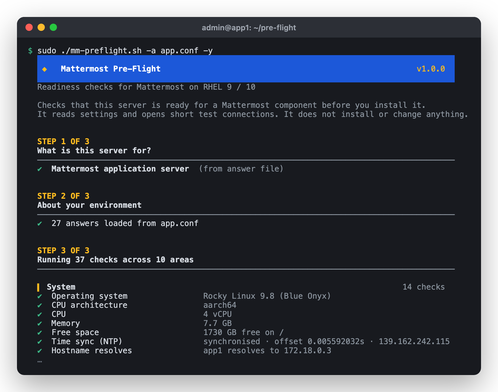
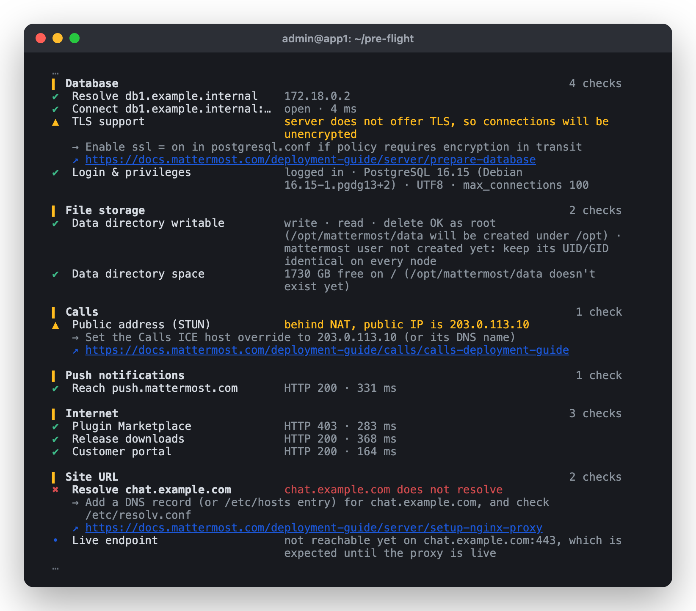
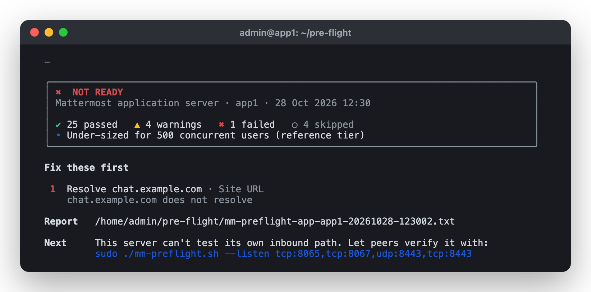
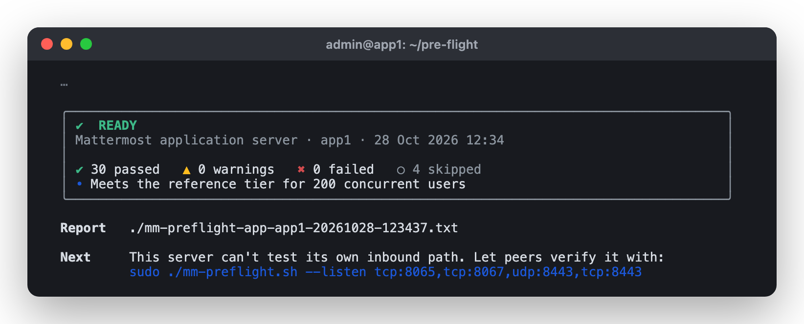
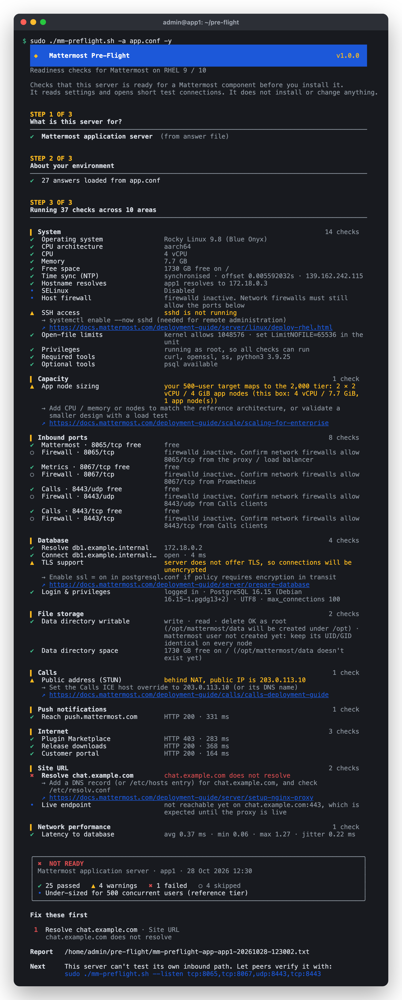

# Mattermost Pre-Flight

Mattermost Pre-Flight checks that a RHEL 9 or 10 server is ready for a Mattermost component before you install it. It asks what the server is for, or reads an answer file, then tests the operating system, sizing, ports, firewall, DNS, TLS, network latency and every service the component depends on.

It reads settings and opens short-lived test connections. It does not install packages, change configuration or open firewall ports.

Each run ends with a verdict, a list of what to fix first, and a plain-text report you can attach to a change ticket.



## Contents

- [Quick start](#quick-start)
- [Requirements](#requirements)
- [Supported roles](#supported-roles)
- [How a run works](#how-a-run-works)
- [Answer files](#answer-files)
- [Answer file reference](#answer-file-reference)
- [What each role checks](#what-each-role-checks)
- [Thresholds](#thresholds)
- [Capacity estimates](#capacity-estimates)
- [Network latency and bandwidth](#network-latency-and-bandwidth)
- [Testing inbound ports with listeners](#testing-inbound-ports-with-listeners)
- [One-off probes](#one-off-probes)
- [Results, report and exit codes](#results-report-and-exit-codes)
- [Command-line options](#command-line-options)
- [Security notes](#security-notes)
- [Limitations](#limitations)
- [Troubleshooting](#troubleshooting)
- [Sources](#sources)

## Quick start

```bash
chmod +x mm-preflight.sh

# Interactive: choose a role and answer the questions
sudo ./mm-preflight.sh

# Use an answer file, and get prompted only for anything missing
sudo ./mm-preflight.sh -a site.conf

# Fully unattended, for automation or CI
sudo ./mm-preflight.sh -a site.conf -y

# Print a commented answer file for one role (or "all")
./mm-preflight.sh --template app > app.conf
```

Run it as root. Without root the firewall, process-owner, `pg_hba.conf` and write-permission checks are limited, and the run tells you which ones.

## Requirements

The script uses only tools that ship with RHEL 9 and 10:

| Tool | Package | Used for |
|---|---|---|
| bash 4.4 or newer | bash | The script itself |
| curl | curl | HTTP and HTTPS checks |
| openssl | openssl | Certificate and TLS checks |
| ss | iproute | Port and listener checks |
| getent | glibc-common | DNS resolution |
| findmnt, runuser | util-linux | NFS mount and write tests |
| python3 (standard library only) | python3 | UDP, STUN, S3, PostgreSQL TLS, latency, bandwidth and listeners |


Two optional packages turn on deeper checks:

| Package | Command | Enables |
|---|---|---|
| postgresql (client) | psql | A real database login, plus version, encoding and privilege checks from the app server. Local server inspection on the database role. |
| openldap-clients | ldapsearch | An LDAP bind with the service account |

Install them with `dnf install -y postgresql openldap-clients`. Without them, those checks show as skipped.

## Supported roles

| Role | Answer value | Use on |
|---|---|---|
| Mattermost application server | `app` | Each Mattermost node, single server or cluster member |
| PostgreSQL database server | `db` | The primary and each replica |
| Reverse proxy / load balancer | `proxy` | NGINX or another proxy in front of Mattermost |
| Calls RTCD server | `rtcd` | Each dedicated Calls media server |
| Calls offloader | `offloader` | The recording, transcription and live captions server |
| Elasticsearch / OpenSearch node | `search` | Each enterprise search node |
| Self-hosted push proxy | `pushproxy` | A push proxy that relays to Apple and Google |

Run the script once on every server, with the role that server will have.

## How a run works

A run has three steps.

1. You choose the role from a numbered list, or the script reads it from `--role` or `ROLE=` in the answer file.
2. It asks about the environment. Each question shows a default in brackets; press Enter to accept it. Leaving an optional question blank skips its checks. Invalid answers (a bad port, a malformed URL) are rejected with the reason, and the question is asked again.
3. It runs the checks. 

| Symbol | Result | Meaning |
|---|---|---|
| ✔ | PASS | Meets the requirement |
| ▲ | WARN | Works, but needs attention, or can't be confirmed until another step is done |
| ✖ | FAIL | Will stop the install or break Mattermost |
| ○ | SKIP | Not applicable, or a tool or input was missing |
| • | INFO | Useful context, not a pass or fail |

Every WARN and FAIL line includes a one-line fix and a link to the relevant page on docs.mattermost.com.



At the end you get a summary card with the verdict, the capacity estimate and counts, a numbered "Fix these first" list, and the path to the report. An interactive run then offers to save your answers, and offers to start test listeners for the ports this server will receive traffic on.



Once everything is fixed, the run reports READY:



<a href="docs/images/full-run.png"></a>

## Answer files

An answer file contains the answers to the questions, so you can run the same checks repeatedly or across many servers.

### Getting one

Print a commented template for a role, or for every role:

```bash
./mm-preflight.sh --template app > app.conf
./mm-preflight.sh --template all > everything.conf
```

`mm-preflight-answers.example.conf` is the output of `--template all`.

After an interactive run, the script offers to save your answers to `mm-preflight-<role>.conf`. To save to a path of your choice, use `--save-answers FILE`.

### Format

```ini
# Lines starting with # are comments
ROLE=app
DB_HOST=db1.example.internal
DB_PORT=5432                    
DB_PASSWORD="p #ssw0rd"         
APP_PEERS=app2.example.internal,app3.example.internal
SMTP_HOST=                      # blank skips the SMTP checks
```

The rules:

- One `KEY=value` per line. Keys are case-insensitive. A leading `export ` is ignored, so the file can also be sourced by other tooling.
- Text after a space and `#` is a comment, unless the value is in single or double quotes. Quoted values are taken literally.
- A blank value skips that optional check.
- Lists are comma or space-separated. Hosts can carry a port, as in `host:port`.
- Yes/no answers accept `yes`, `no`, `y`, `n`, `true` and `false`.
- Windows line endings are handled.
- Lines that aren't `KEY=value` are reported and ignored.

### How answers are used

- With `-a FILE`, every value in the file is validated. Anything missing is asked interactively.
- With `-a FILE -y`, nothing is asked. Missing optional keys take their defaults. A missing required key, or an invalid value, stops the run with exit code 64 and names the key.
- `--role` overrides `ROLE=` in the file.
- If the file contains a password or secret key and is readable by other users, the script warns and suggests `chmod 600`.

Secrets are never written by `--save-answers` or the end-of-run save. Add them to the file by hand if you need them, and keep the file at mode 600.

### Reusing one file across servers

Keys that don't apply to a role are ignored, so you can keep a single site file and override the role:

```bash
sudo ./mm-preflight.sh -a site.conf --role app -y
sudo ./mm-preflight.sh -a site.conf --role db -y
```

## Answer file reference

### All roles

| Key | Default | Description |
|---|---|---|
| `ROLE` | (asked) | `app`, `db`, `proxy`, `rtcd`, `offloader`, `search` or `pushproxy` |
| `MIN_CPU` | per role | Override the vCPU warning floor |
| `MIN_RAM_GB` | per role | Override the memory warning floor |
| `MIN_DISK_GB` | per role | Override the free-space warning floor |
| `DISK_PATH` | per role | Path whose free space is checked |
| `SSH_PORT` | 22 | Port sshd should listen on |
| `PERF_TEST` | no | `yes` runs bandwidth tests to peers |
| `PERF_PORT` | 18999 | Port the peers' bandwidth listener uses |
| `PERF_MB` | 64 | Megabytes sent each way per bandwidth test |
| `BANDWIDTH_WARN_MBPS` | 500 | Warn below this throughput |
| `LATENCY_WARN_MS` | 5 | Warn above this average round trip |
| `LATENCY_FAIL_MS` | 30 | Fail above this average round trip |

### Internet access (app, offloader, pushproxy; `AIR_GAPPED` also on rtcd)

| Key | Default | Description |
|---|---|---|
| `AIR_GAPPED` | no | `yes` skips internet checks and STUN |
| `OUTBOUND_PROXY` | (blank) | HTTP proxy URL, e.g. `http://proxy.internal:3128` |
| `NO_PROXY_LIST` | localhost,127.0.0.1 | Hosts and `.domains` that bypass the proxy |

When `OUTBOUND_PROXY` is set, the script exports `HTTP_PROXY`, `HTTPS_PROXY` and `NO_PROXY` for its own HTTP checks, the same way Mattermost would use them.

### app

| Key | Default | Description |
|---|---|---|
| `SITE_URL` | (blank) | URL users open, e.g. `https://chat.example.com` |
| `APP_PEERS` | (blank) | Other app nodes in the cluster |
| `TARGET_USERS` | (blank) | Expected peak concurrent users, compared with the reference tiers |
| `DB_HOST` | (required) | PostgreSQL primary, or PgBouncer |
| `DB_PORT` | 5432 | |
| `DB_NAME` | mattermost | |
| `DB_USER` | mmuser | |
| `DB_SSLMODE` | prefer | `disable`, `prefer`, `require`, `verify-ca` or `verify-full` |
| `DB_PASSWORD` | (blank) | Secret. Enables the psql login test. Never saved. |
| `DB_REPLICAS` | (blank) | Read replicas, `host[:port]` |
| `FILE_STORE` | local | `local`, `nfs` or `s3` |
| `DATA_DIR` | /opt/mattermost/data | For `local` and `nfs` |
| `S3_ENDPOINT` | https://s3.amazonaws.com | For `s3`, e.g. `https://minio.internal:9000` |
| `S3_BUCKET` | (required for s3) | |
| `S3_REGION` | eu-west-1 | |
| `S3_PATH_STYLE` | no | `yes` for MinIO and most on-premises stores |
| `S3_ACCESS_KEY` | (blank) | Blank skips the write test (e.g. IAM roles) |
| `S3_SECRET_KEY` | (blank) | Secret. Never saved. |
| `SMTP_HOST` | (blank) | Blank skips email checks |
| `SMTP_SECURITY` | starttls | `starttls`, `tls` or `none` |
| `SMTP_PORT` | 587, 465 or 25 | Follows `SMTP_SECURITY` |
| `LDAP_HOST` | (blank) | Blank skips LDAP checks |
| `LDAP_SECURITY` | ldaps | `ldaps`, `starttls` or `none` |
| `LDAP_PORT` | 636 or 389 | Follows `LDAP_SECURITY` |
| `LDAP_BIND_DN` | (blank) | Enables the bind test (needs ldapsearch) |
| `LDAP_BIND_PASSWORD` | (blank) | Secret. Never saved. |
| `LDAP_BASE_DN` | (blank) | |
| `SSO_METADATA_URL` | (blank) | SAML or OpenID metadata URL |
| `SEARCH_URL` | (blank) | e.g. `https://search.internal:9200` |
| `SEARCH_USER` | (blank) | |
| `SEARCH_PASSWORD` | (blank) | Secret. Never saved. |
| `REDIS_HOST` | (blank) | `host[:port]`, port 6379 by default |
| `CALLS_MODE` | integrated | `integrated`, `rtcd` or `none` |
| `RTC_PORT` | 8443 | Calls media port (integrated mode) |
| `ICE_HOST_OVERRIDE` | (blank) | Public IP or name clients use, if behind NAT |
| `RTCD_HOSTS` | (required for rtcd) | `host[:api-port]`, API port 8045 by default |
| `OFFLOADER_URL` | (blank) | e.g. `http://offloader.internal:4545` |
| `STUN_SERVER` | stun.global.calls.mattermost.com:3478 | Blank to skip; not used when air-gapped |
| `PUSH_SERVER` | https://push.mattermost.com | `https://hpns-de.mattermost.com` for the EU, or your push proxy. Blank to skip. |

### db

| Key | Default | Description |
|---|---|---|
| `DB_PORT` | 5432 | |
| `PG_MIN_VERSION` | 15 | 15 for Mattermost v12.0 and later, 14 for v11.7 ESR |
| `DB_NAME` | mattermost | |
| `DB_USER` | mmuser | |
| `APP_NODES` | (blank) | App servers that will connect; checked against `pg_hba.conf` |
| `MAX_OPEN_CONNS` | 300 | `SqlSettings.MaxOpenConns` per app node, used to size `max_connections` |
| `DB_PEERS` | (blank) | Replication peers |
| `TARGET_USERS` | (blank) | Expected peak concurrent users |

### proxy

| Key | Default | Description |
|---|---|---|
| `SITE_URL` | (required) | |
| `APP_NODES` | (required) | Upstream app servers, `host[:port]`, port 8065 by default |
| `TLS_CERT` | (blank) | PEM certificate with the full chain |
| `TLS_KEY` | (blank) | Private key, for the match test |

### rtcd

| Key | Default | Description |
|---|---|---|
| `RTC_PORT` | 8443 | Media port, UDP and TCP |
| `RTCD_API_PORT` | 8045 | API port the app nodes connect to |
| `ICE_HOST_OVERRIDE` | (blank) | |
| `AIR_GAPPED` | no | |
| `STUN_SERVER` | stun.global.calls.mattermost.com:3478 | |

### offloader

| Key | Default | Description |
|---|---|---|
| `SITE_URL` | (required) | Recording jobs join calls through this URL |
| `RTC_TARGET` | (required) | RTCD server (or the app server for integrated Calls), `host[:port]`, port 8443 by default |
| `OFFLOADER_PORT` | 4545 | |
| `OFFLOADER_USER` | calls-offloader | Service user that runs the jobs |

### search

| Key | Default | Description |
|---|---|---|
| `SEARCH_PORT` | 9200 | HTTP port |
| `SEARCH_TRANSPORT_PORT` | 9300 | Node-to-node port |
| `SEARCH_PEERS` | (blank) | Other search nodes |
| `TARGET_USERS` | (blank) | Expected peak concurrent users |

### pushproxy

| Key | Default | Description |
|---|---|---|
| `PUSH_PROXY_PORT` | 8066 | |

## What each role checks

### System checks (every role)

| Check | Pass condition |
|---|---|
| Operating system | RHEL, Rocky, AlmaLinux, Oracle Linux or CentOS Stream, version 9 or 10 |
| CPU architecture | x86_64 or aarch64 |
| CPU, memory, free space | At or above the role's floor (see [Thresholds](#thresholds)) |
| Time sync | chrony reports `Leap status: Normal` and an offset of 1 second or less |
| Hostname resolves | The FQDN resolves to a non-loopback address |
| SELinux | Reported; Enforcing links to the RHEL contexts guide |
| Host firewall | Reports whether firewalld is active and which zones |
| SSH access | sshd is running, listening on `SSH_PORT`, and allowed by firewalld |
| Open-file limits | `fs.nr_open` and `fs.file-max` are at least 65,536 |
| Privileges | Running as root |
| Required and optional tools | Present, with the dnf command for anything missing |

### Inbound ports

For each port the role receives traffic on, two checks run: whether the port is free (or already held by the expected service), and whether firewalld allows it in the active zones. Ports, services and rich rules are all recognised.

| Role | Ports |
|---|---|
| app | 8065/tcp, 8067/tcp (metrics); 8074/tcp and 8074/udp when `APP_PEERS` is set; `RTC_PORT` udp and tcp when Calls is integrated |
| db | `DB_PORT`/tcp |
| proxy | 80/tcp, 443/tcp |
| rtcd | `RTC_PORT` udp and tcp, `RTCD_API_PORT`/tcp |
| offloader | `OFFLOADER_PORT`/tcp |
| search | `SEARCH_PORT`/tcp, `SEARCH_TRANSPORT_PORT`/tcp |
| pushproxy | `PUSH_PROXY_PORT`/tcp |

A server can't test its own inbound path from outside. See [Testing inbound ports with listeners](#testing-inbound-ports-with-listeners).

### app

| Area | Checks |
|---|---|
| Capacity | App-node sizing against the reference tiers |
| Database | DNS, TCP connect, whether the server offers TLS (and whether that suits `DB_SSLMODE`), psql login with version 15 or newer, UTF8 encoding and CREATE on schema `public`, each replica reachable |
| File storage, local | Directory writable as the `mattermost` user, free space |
| File storage, NFS | Path is on an NFS mount, the mount isn't `soft`, NFS server reachable on 2049, write/read/delete as `mattermost`, free space |
| File storage, S3 | DNS, TCP, certificate, and a signed PUT, GET and DELETE of a test object |
| Cluster | For each peer: DNS, gossip on 8074/tcp and 8074/udp |
| Email | DNS, TCP, a `220` SMTP greeting, the STARTTLS or TLS certificate |
| Directory and SSO | LDAP DNS, TCP, LDAPS or StartTLS certificate, service-account bind; IdP metadata URL reachable |
| Search and cache | Search DNS, certificate, cluster responding (version 8 or 9, or OpenSearch); Redis answers `PING` |
| Calls | Integrated: public IP via STUN and match against the ICE host override. RTCD: DNS, API reachable and `/version` answering. Offloader API reachable. |
| Push notifications | Push server reachable |
| Internet | Plugin Marketplace, release downloads and customer portal reachable, skipped when air-gapped |
| Outbound proxy | Proxy reachable, and internal services (RTCD, offloader, search, S3) listed in `NO_PROXY` |
| Site URL | DNS; if the endpoint is live, a trusted certificate and `/api/v4/system/ping` |
| Network performance | Latency to the database, replicas, peers, NFS, S3, RTCD, search and Redis; bandwidth when `PERF_TEST=yes` |

### db

| Area | Checks |
|---|---|
| Capacity | Writer sizing and replica count against the reference tiers |
| PostgreSQL | Installed version 15 or newer, service running, listening on a network interface (not only loopback), `password_encryption` is scram-sha-256, `max_connections` large enough, database and role exist with UTF8 encoding, data-directory free space |
| Client access | `pg_hba.conf` has a rule for each app node, evaluated in file order; `reject`, `trust` and cleartext `password` are flagged |
| Replication | Each peer reachable on the database port |
| Network performance | Latency to each app node and peer |

Local inspection needs root and the psql client on the database server. If PostgreSQL isn't installed yet, these checks are skipped with a warning.

### proxy

| Area | Checks |
|---|---|
| Capacity | Compared with the 16 vCPU / 64 GiB proxy used in every reference tier |
| Site URL | DNS, and whether it resolves to this server or to a VIP in front of it |
| Upstream app servers | DNS and TCP to each node |
| TLS certificate | Readable PEM, not expired, covers the site hostname, chain verifies against the system trust store, not expiring within 30 days, private key matches |
| NGINX | If nginx is installed: config tests clean, and the Mattermost site sets the WebSocket `Upgrade` header and `client_max_body_size` |
| Network performance | Latency to each app node |

### rtcd

| Area | Checks |
|---|---|
| Kernel tuning | `net.core.rmem_max` and `net.core.wmem_max` at least 16,777,216 |
| NAT and ICE | Public IP via STUN, compared with the ICE host override |

### offloader

| Area | Checks |
|---|---|
| Container runtime | Docker Engine installed and the daemon reachable (the podman shim is flagged), service user exists and is in the `docker` group, recorder and transcriber images present (required when air-gapped) |
| Mattermost | Site URL resolves and answers over HTTPS |
| Calls media | DNS, TCP and UDP to the RTCD (or app) media port |
| Internet | Docker Hub reachable, unless air-gapped |
| Network performance | Latency to the media endpoint and the site |

### search

| Area | Checks |
|---|---|
| Capacity | Node sizing and node count against the reference tiers |
| Kernel tuning | `vm.max_map_count` at least 262,144; swap disabled |
| Cluster peers | Each peer reachable on the transport port, with latency |

### pushproxy

| Area | Checks |
|---|---|
| Apple and Google | `api.push.apple.com`, `fcm.googleapis.com` and `oauth2.googleapis.com` reachable over HTTPS |

## Thresholds

Thresholds marked "Mattermost" come from Mattermost's documentation. Thresholds marked "default" are sensible defaults chosen for this tool, and you can change them in the answer file.

### Sizing floors

These produce warnings only. Memory allows 8% headroom, because the kernel reserves some of the installed RAM.

| Role | vCPU | RAM (GiB) | Free disk (GB) | Disk path checked | Source |
|---|---|---|---|---|---|
| app | 2 | 4 | 20 | /opt, and `DATA_DIR` | Mattermost smallest app tier |
| db | 2 | 4 | 20 | /var, and the PostgreSQL data directory | default |
| proxy | 1 | 2 | 5 | /var/log | default |
| rtcd | 2 | 4 | 5 | /opt | default |
| offloader | 4 | 8 | 20 | /var/lib/docker | default |
| search | 2 | 8 | 20 | /var/lib | default |
| pushproxy | 1 | 1 | 5 | /opt | default |

Override with `MIN_CPU`, `MIN_RAM_GB`, `MIN_DISK_GB` and `DISK_PATH`. For actual capacity, the [capacity estimate](#capacity-estimates) is the better guide.

### Other thresholds

| Check | Warn | Fail | Source |
|---|---|---|---|
| PostgreSQL version | | Below `PG_MIN_VERSION` (15) | Mattermost |
| PostgreSQL `max_connections` | Below `MAX_OPEN_CONNS` × app nodes + 20 | | default |
| Elasticsearch version | Below 8 | | Mattermost |
| Clock offset | Above 1 second | Not synchronised | default |
| Open files (`fs.nr_open`, `fs.file-max`) | Below 65,536 | | default |
| Certificate expiry | Within 30 days | Expired | default |
| RTCD UDP buffers (`rmem_max`, `wmem_max`) | Below 16,777,216 | | Mattermost RTCD guide |
| `vm.max_map_count` (search) | | Below 262,144 | Elasticsearch |
| Average TCP round trip | Above 5 ms, or any packet loss | Above 30 ms | default (`LATENCY_WARN_MS`, `LATENCY_FAIL_MS`) |
| Bandwidth, either direction | Below 500 Mbit/s | | default (`BANDWIDTH_WARN_MBPS`) |
| Network timeout per check | | 5 seconds | default (`--timeout`) |

Mattermost doesn't publish latency or bandwidth figures. The defaults suit servers in one data centre. The the design spans sites, this isn't officially supported.

## Capacity estimates

On the app, db and search roles, the script compares the server with Mattermost's published reference architectures. It finds the largest tier that this server's vCPU, memory and node count can match, and reports that tier's user count together with what the next tier needs.

| Concurrent users | App nodes (vCPU / GiB) | Database (writer + readers) | Search nodes |
|---|---|---|---|
| 200 | 1 × 2 / 4 | 1 × 2 / 16 | none |
| 2,000 | 2 × 2 / 4 | 1 + 1, each 2 / 16 | 2 × 4 / 32 |
| 15,000 | 2 × 4 / 8 | 1 + 1, each 4 / 32 | 2 × 4 / 32 |
| 30,000 | 2 × 8 / 16 | 1 + 1, each 8 / 64 | 4 × 8 / 64 |
| 50,000 | 5 × 8 / 16 | 1 + 4, each 8 / 64 | 4 × 8 / 64 |
| 100,000 | 6 × 16 / 32 | 1 + 5, each 16 / 128 | 4 × 8 / 64 |

Every tier was tested with a 16 vCPU / 64 GiB proxy. Mattermost notes that this is more than small deployments need, so the proxy role reports it as information only.

How to read the estimate:

- The numbers are concurrent users, not registered accounts. Concurrent users are usually far fewer.
- Node count matters as much as server size. The app node count is `APP_PEERS` + 1, the database count is `DB_PEERS` + 1, and the search count is `SEARCH_PEERS` + 1. A single large app server still maps to the 200-user tier, because no published architecture puts more users on one node.
- A single app server also gets Mattermost's small-team guidance: up to 1,000 registered users on 1 vCPU / 2 GB, and up to 2,000 on 2 vCPU / 4 GB.
- The tiers come from load tests on AWS with PostgreSQL 14, 100 million posts and Mattermost v9.5 ESR. Real usage varies, so treat the result as a starting point and validate large deployments with the Mattermost load-test tool.
- RTCD, the offloader and the push proxy aren't covered by the reference architectures, so they have no capacity estimate.

Set `TARGET_USERS` to compare against your expected peak instead. The check warns if this server falls short of the tier for that target, and says what that tier needs, for example "your 10,000-user target maps to the 15,000 tier: 2 × 4 vCPU / 8 GiB app nodes". Targets above 100,000 are reported as beyond the published tiers.

## Network latency and bandwidth

### Latency

Latency runs on every role that has peers. For each target, the script opens 10 TCP connections and reports the average, minimum, maximum and jitter of the connection times, plus any lost attempts. It stops after 3 timeouts in a row.

A refused connection still completes a full round trip, so latency can be measured before the target service is installed, as long as no firewall drops the packets.

| Role | Latency targets |
|---|---|
| app | Database, replicas, cluster peers (8074), NFS server (2049), S3 endpoint, RTCD API, search, Redis |
| db | Each app node (8065), each replication peer |
| proxy | Each upstream app node |
| offloader | The media endpoint and the site URL |
| search | Each cluster peer (transport port) |

### Bandwidth

Bandwidth testing is optional because it needs a listener on the other end and moves real data. To use it:

1. On each peer, start a bandwidth listener:

   ```bash
   sudo ./mm-preflight.sh --listen perf:18999
   ```

2. On the server being checked, set `PERF_TEST=yes` (or answer yes when asked) and run the pre-flight.

The script sends `PERF_MB` megabytes (64 by default) to each peer and then downloads the same amount, and reports Mbit/s in each direction. Each host is tested once, even if it appears in several roles. A peer without a listener shows as skipped, with the command to start one.

## Testing inbound ports with listeners

A server can confirm that a port is free and that its own firewalld allows it, but it can't see firewalls between it and its peers. Listeners close that gap.

On the server that will receive the traffic:

```bash
sudo ./mm-preflight.sh --listen tcp:8065,tcp:8067,udp:8443,perf:18999
```

| Listener | Behaviour |
|---|---|
| `tcp:PORT` | Accepts connections and logs the source address |
| `udp:PORT` | Echoes each datagram back and logs the source address |
| `perf:PORT` | Accepts bandwidth tests and logs the measured throughput |

Then run the pre-flight (or a [probe](#one-off-probes)) on the peers. A peer check that would otherwise say "nothing listening yet" gets a definite pass or fail, and each successful connection appears on the listener's screen.

Listeners stop after 15 minutes (change with `--duration SECONDS`) or on Ctrl-C. Ports already in use are reported and skipped. If firewalld doesn't allow a listener port, the script warns that peers will fail until it is opened; it doesn't open the port for you. Ports below 1024 need root.

At the end of an interactive run, the script prints the exact `--listen` command for this server's free inbound ports and offers to start it.

## One-off probes

Probes test a single path from any machine with the script on it, such as a client network checking that UDP 8443 reaches the Calls server:

```bash
./mm-preflight.sh --probe udp:rtcd1.example.internal:8443
./mm-preflight.sh --probe tcp:db1:5432,rtt:db1:5432,perf:app2:18999
```

| Probe | Test |
|---|---|
| `tcp:HOST:PORT` | TCP connect |
| `udp:HOST:PORT` | UDP round trip (definitive when the far end runs a `udp:` listener) |
| `rtt:HOST:PORT` | Latency |
| `perf:HOST:PORT` | Bandwidth, against a `perf:` listener |

Probes don't need root and don't write a report. Exit code 0 means all passed, 1 means warnings, 2 means failures.

## Results, report and exit codes

### The report

Every run writes `mm-preflight-<role>-<host>-<YYYYMMDD-HHMMSS>.txt` to the current directory, or to `--report-dir`. If that directory isn't writable, it uses `/tmp`. The report contains:

- The result, role, host, OS, user, date, answer file and capacity estimate
- Every failure and warning, with its result, fix and documentation link
- Every check, grouped by section
- The answers used, with secrets masked and the S3 access key shortened
- The `--listen` command for this server's inbound ports

An interrupted run (Ctrl-C) writes a partial report.

### Verdicts and exit codes

| Exit code | Verdict | Meaning |
|---|---|---|
| 0 | READY | No failures or warnings |
| 1 | READY WITH WARNINGS | No failures; review the warnings |
| 2 | NOT READY | At least one failure |
| 64 | | Usage error: bad option, bad answer file value, or a missing required answer |
| 130 | | Interrupted |

Skipped and informational checks don't affect the verdict.

### Using it in automation

```bash
sudo ./mm-preflight.sh -a site.conf --role app -y --no-color --report-dir /var/log/preflight
case $? in
  0) echo "ready" ;;
  1) echo "ready, review warnings" ;;
  *) echo "not ready"; exit 1 ;;
esac
```

## Command-line options

| Option | Description |
|---|---|
| `-a`, `--answers FILE` | Read answers from FILE |
| `-r`, `--role ROLE` | Set the role; overrides `ROLE=` in the file |
| `-y`, `--non-interactive` | Never prompt; use the answer file and defaults |
| `--save-answers FILE` | Save the answers (secrets excluded) to FILE after the run |
| `--report-dir DIR` | Directory for the report (default: current directory) |
| `--timeout SECONDS` | Network timeout per check (default: 5) |
| `--template ROLE` | Print an answer-file template for a role, or `all`, and exit |
| `--listen SPECS` | Start listeners: `tcp:PORT`, `udp:PORT`, `perf:PORT`, comma-separated |
| `--duration SECONDS` | How long `--listen` runs (default: 900) |
| `--probe SPECS` | Run probes: `tcp`, `udp`, `rtt` or `perf` with `:HOST:PORT`, comma-separated |
| `--no-color` | Plain output (`NO_COLOR` is honoured too) |
| `--ascii` | ASCII symbols only |
| `-h`, `--help` | Show help |
| `-V`, `--version` | Show the version |

## Security notes

- Passwords and secret keys are typed with echo off, never saved by the script, and masked in the report.
- They are passed to tools through mode-600 temporary files or environment variables, never on the command line, so they don't show up in `ps`. The temporary directory is removed on exit.
- Answer-file values are validated and never evaluated as shell code.
- The S3 test writes, reads and deletes one object at `mm-preflight/<host>-<timestamp>.txt`. If the read fails, it still tries to delete the object.
- The NFS and local storage tests create and remove a hidden file in the data directory.
- Listeners accept connections from any address for as long as they run. Stop them when testing is done.

## Limitations

- The script is written for RHEL 9 and 10. It runs on other Linux distributions, but the OS, package and firewall advice assume RHEL.
- `pg_hba.conf` rules that use hostnames, `samehost`, `samenet` or IPv6 addresses aren't evaluated.
- The firewalld check reads ports, services and rich rules in the active zones. It doesn't read nftables or iptables rules added outside firewalld, or network firewalls.
- UDP gives no reply when it's filtered or when nothing is listening, so a UDP check without a listener on the far end can only warn.
- OpenSearch 1.x isn't flagged, although Mattermost v12.0 requires OpenSearch 2.x or newer.
- The S3 test needs access keys; IAM role credentials aren't fetched.
- Capacity estimates use the published tiers only, and don't account for your users' activity, plugins or integrations.

## Troubleshooting

| Symptom | Cause and fix |
|---|---|
| Many checks say "run as root" | Re-run with `sudo` |
| "nothing is listening on PORT yet" | Expected before the service is installed. Run `--listen` on that host, then re-run. |
| "timed out ... packets are probably being dropped" | A firewall or security group is dropping traffic. Open the port on every hop. |
| "rejected by a firewall REJECT rule" | The target's host firewall rejects the port. Check `firewall-cmd --list-all` there. |
| TLS "certificate not trusted" | Add your internal CA: copy it to `/etc/pki/ca-trust/source/anchors/` and run `update-ca-trust` |
| The answer file stops the run with exit 64 | The message names the key and the problem. Fix the value, or remove `-y` to be prompted. |
| Garbled symbols | The terminal isn't UTF-8. Use `--ascii`, or set `LANG=en_GB.UTF-8`. |
| The bandwidth test says "not a bandwidth listener" | The peer is running `tcp:` instead of `perf:` on that port |

## Sources

- [Software and hardware requirements](https://docs.mattermost.com/deployment-guide/software-hardware-requirements)
- [Reference architectures (scaling for enterprise)](https://docs.mattermost.com/deployment-guide/scale/scaling-for-enterprise)
- [Network ports and outbound proxy](https://docs.mattermost.com/deployment-guide/server/prepare-network)
- [Prepare the database](https://docs.mattermost.com/deployment-guide/server/prepare-database)
- [Prepare file storage](https://docs.mattermost.com/deployment-guide/server/prepare-file-storage)
- [High availability cluster-based deployment](https://docs.mattermost.com/deployment-guide/server/high-availability-cluster-based-deployment)
- [RTCD setup and configuration](https://docs.mattermost.com/deployment-guide/calls/calls-rtcd-setup)
- [Calls offloader setup and configuration](https://docs.mattermost.com/deployment-guide/calls/calls-offloader-setup)
- [Enterprise search](https://docs.mattermost.com/deployment-guide/scale/enterprise-search)
- [Deploy on RHEL](https://docs.mattermost.com/deployment-guide/server/linux/deploy-rhel.html)
